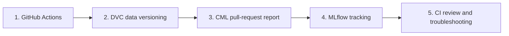
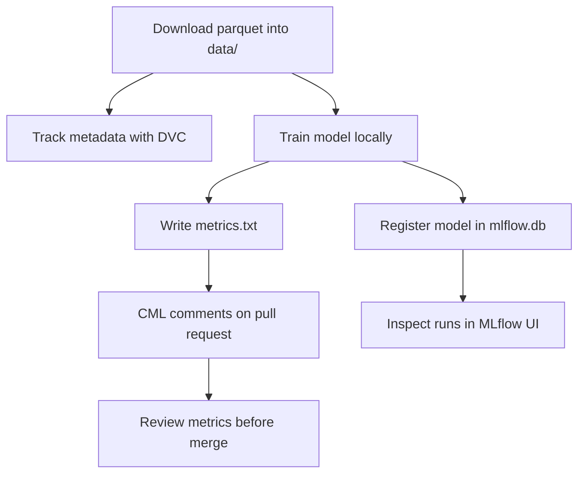

# GitHub Actions and CI/CD for Machine Learning

This repository teaches how GitHub Actions, DVC, and CML fit into a small machine-learning CI/CD workflow. The goal is to help you move from a simple pull-request test to a reproducible ML workflow that tracks data with DVC, trains a model, and publishes metrics back to a pull request.

## Learning Path



| Step | File | What you practice |
| --- | --- | --- |
| 1 | [01-intro-github-actions.md](01-intro-github-actions.md) | Create a pull-request workflow, run tests, and protect `main`. |
| 2 | [02-intro-to-dvc.md](02-intro-to-dvc.md) | Track a Green Taxi parquet file with DVC and push it to a local DVC remote. |
| 3 | [03-cicd-workflow-with-cml.md](03-cicd-workflow-with-cml.md) | Download data inside GitHub Actions, train the model, and post metrics with CML. |
| 4 | [04-mlflow-model-tracking.md](04-mlflow-model-tracking.md) | Inspect local MLflow experiments, metrics, tags, and registered model versions. |
| 5 | [05-ci-review-and-troubleshooting.md](05-ci-review-and-troubleshooting.md) | Read CI logs, interpret CML comments, and decide whether a model change is merge-ready. |

## Local First

This repository is designed to run locally first. The main path needs only:

- a Python virtual environment;
- the January 2025 Green Taxi parquet file downloaded into `data/`;
- a local SQLite-backed MLflow store;
- an optional local DVC remote directory when practicing DVC.



## Mermaid Diagrams

This README and the lesson files use Mermaid diagrams. GitHub renders them automatically in Markdown, and many Markdown previewers can render them locally. If your editor shows the Mermaid source as plain text, read the diagram directly or preview the file on GitHub.

## Environment

The GitHub Actions workflow pins Python 3.11.3 for repeatability. Locally, use Python 3.11 or a newer standard Python build that can create virtual environments and install the pinned packages in `requirements.txt`. The setup commands below use the standard Python launchers for each platform.

On macOS, XGBoost also needs the OpenMP runtime:

```bash
brew install libomp
```

## Setup

Fork this repository first, then clone your fork locally.

### macOS

```bash
python3 -m venv .venv
source .venv/bin/activate
python -m pip install --upgrade pip
python -m pip install -r requirements.txt
python -c "import sys; print(sys.executable); print(sys.version)"
```

### Windows

For `PowerShell` CLI:

```powershell
py -3 -m venv .venv
.\.venv\Scripts\Activate.ps1
python -m pip install --upgrade pip
python -m pip install -r requirements.txt
python -c "import sys; print(sys.executable); print(sys.version)"
```

For `Git-Bash` CLI:

```bash
py -3 -m venv .venv
source .venv/Scripts/activate
python -m pip install --upgrade pip
python -m pip install -r requirements.txt
python -c "import sys; print(sys.executable); print(sys.version)"
```

If `python3 -m venv .venv` or `py -3 -m venv .venv` cannot create an environment, install a standard Python build for your operating system and rerun the same commands. A healthy Python installation should include the `venv` module and `pip`.

## Data Setup

Download the January 2025 Green Taxi data into `data/` before running the training script locally:

```bash
mkdir -p data
curl -L --fail -o data/green_tripdata_2025-01.parquet \
  https://d37ci6vzurychx.cloudfront.net/trip-data/green_tripdata_2025-01.parquet
```

The data file is intentionally ignored by Git. In the DVC lesson, you will add a `.dvc` metadata file and push the actual parquet file to a local DVC remote directory.

## Run Training Locally

For a local smoke test, use a SQLite-backed MLflow store:

```bash
export MLFLOW_TRACKING_URI="sqlite:///mlflow.db"
python src/train.py --cml-run
cat metrics.txt
```

The `--cml-run` flag writes `metrics.txt`, which CML posts back to the pull request in the GitHub Actions workflow.

The local training run creates generated files that are ignored by Git:

| Path | Purpose |
| --- | --- |
| `data/green_tripdata_2025-01.parquet` | Raw taxi data used for training. |
| `mlflow.db` | Local MLflow tracking and model registry database. |
| `mlruns/` | Local MLflow run artifacts. |
| `mlartifacts/` | Local MLflow artifact-serving directory that can appear when using the UI. |
| `metrics.txt` | Short report consumed by CML. |

To inspect the tracked experiment locally, start the MLflow UI after one training run:

```bash
mlflow ui --backend-store-uri sqlite:///mlflow.db
```

Then open the local URL printed by MLflow, usually `http://127.0.0.1:5000`.

## Clean Run Checklist

From a fresh clone, you should be able to run this local path without external credentials:

1. Create and activate the Python environment.
2. Install `requirements.txt`.
3. Download the Green Taxi parquet file into `data/`.
4. Run `python src/train.py --cml-run` with `MLFLOW_TRACKING_URI="sqlite:///mlflow.db"`.
5. Confirm `metrics.txt` contains train RMSE, test RMSE, and the number of rows after filtering.
6. Optional: follow the DVC lesson to push the parquet file into `../dvc-local-remote`.
7. Optional: open the MLflow UI and inspect the latest training run.

The CML pull-request comment runs in GitHub Actions with the built-in `GITHUB_TOKEN`; no extra credentials are required for the local-first workflow.

## Learning Objectives

By the end of the repo, you should be able to:

- explain when CI, continuous delivery, and continuous deployment differ;
- create a GitHub Actions workflow that runs on pull requests;
- protect `main` with review and status-check requirements;
- use DVC metadata to version a large ML dataset without committing the data file;
- connect DVC to a local remote directory;
- run a CML workflow that trains a model and comments metrics on a pull request;
- inspect local MLflow runs, metrics, tags, and registered model versions;
- explain how CML uses GitHub's built-in token to comment on a pull request;
- troubleshoot failed CI runs and decide whether metric changes are merge-ready.

## Practice Tasks

- Add one more pytest check to the first GitHub Actions exercise and confirm the pull-request check still passes.
- After adding the taxi data with DVC, inspect the generated `.dvc` file and explain which fields Git tracks.
- Run `src/train.py --cml-run` locally and compare the generated `metrics.txt` with the CML report in a pull request.
- Open the MLflow UI and compare two runs after changing one model parameter.
